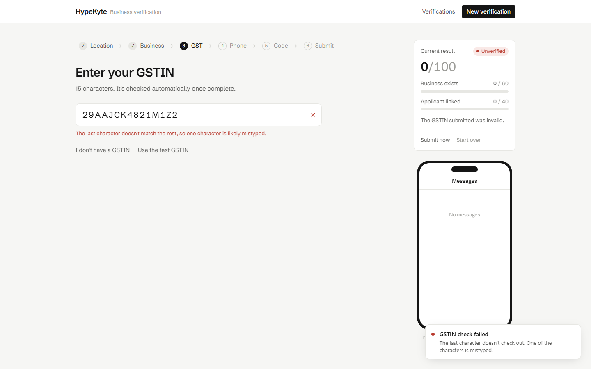
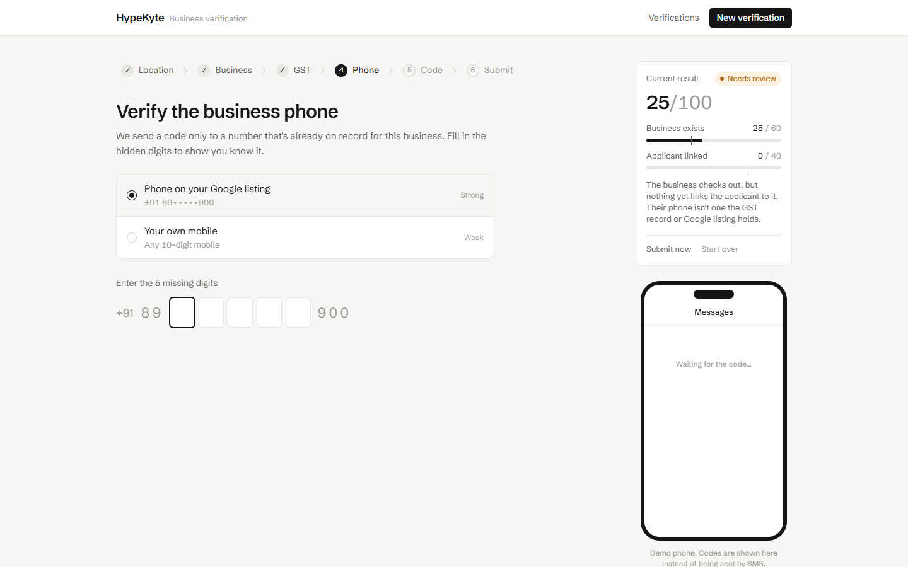
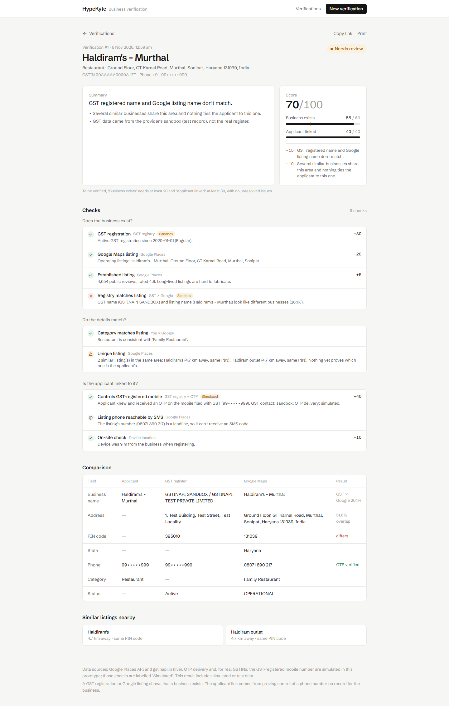
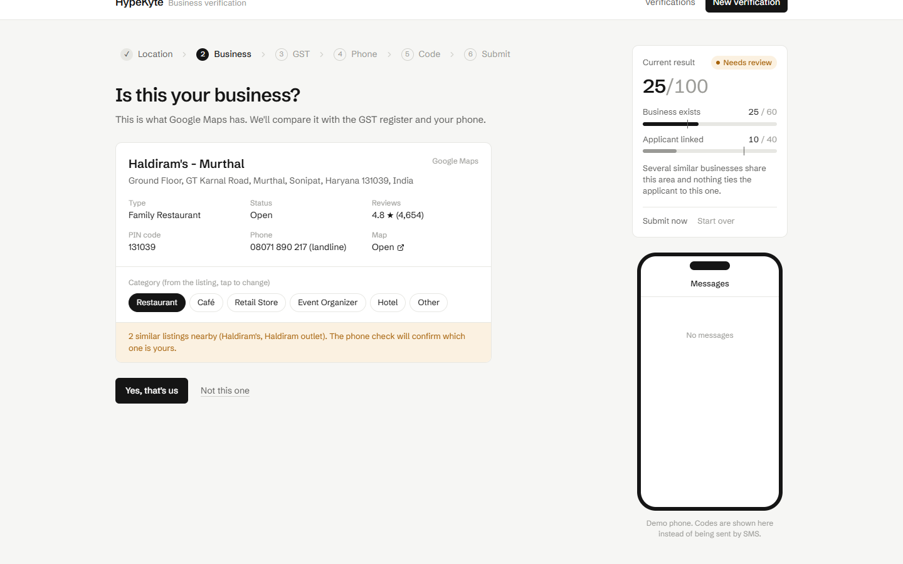

# Scenarios and decisions

Two kinds of evidence back this document:

- **Automated tests**: `backend/tests/test_scenarios.py`, 20 tests. Google Places and gstinapi.in are replaced by fakes that return
  the real response shapes (see `backend/samples/`). Everything else is the production code, called through the HTTP API.
- **Live UI runs**: `docs/capture_screenshots.py` drives the real app against the live APIs. Screenshots are in `docs/screenshots/`.
  The GST account has only free credits, so live runs use the provider's sandbox GSTIN and free not-found lookups. Real-GSTIN
  matches (scenarios 1 and 4) are shown through the tests.

How to read a result: **Business exists** (max 60) and **Applicant linked** (max 40) must reach 20 and 30, with no unresolved conflicts, for VERIFIED.
Every conflict also deducts points by severity.

---

## 1. Valid GSTIN with a matching business name → **VERIFIED**

`test_1_valid_gstin_matching_name_gst_mobile_otp_is_verified`, `test_1b_gstin_plus_matching_listing_scores_higher`

- Applicant enters "Kaveri Textiles" and the GSTIN. The register returns *KAVERI TEXTILES PRIVATE LIMITED / Kaveri Textiles*, Active.
- Name check: legal suffixes are stripped, so the score is 100% → match.
- The applicant fills in the 5 hidden digits of the **GST-registered mobile** and confirms the OTP.
- Exists 30 + Belongs 40 → **VERIFIED**.
- 1b adds the Google listing. Its PIN (560011) isn't the principal-address PIN but **is a registered branch** in
  `additional_addresses`, so the cross-check passes (+10). Score ≥ 95.

**Why:** a GST record proves the business exists. Controlling the mobile *filed with that GST record* is the closest thing to
proof of association available from these two APIs.

## 2. Invalid GSTIN → **UNVERIFIED**

`test_2_invalid_checksum_gstin_alone_is_unverified`, `test_2b_unregistered_gstin_is_unverified`, `test_2d_cancelled_gstin_is_unverified`
· live: `d1_invalid_checksum.png`, `d2_invalid_dossier.png`, `e1_not_registered.png`, `e2_not_registered_dossier.png`

| Variant | Where it's caught | Cost |
|---|---|---|
| Wrong format | in the browser as you type, and again on the server | free |
| Bad check character (`29AAJCK4821M1Z2`) | mod-36 checksum, offline | free |
| Well-formed but unregistered (`29AAJCK4821M1Z1`) | gstinapi.in returns 404 | free (not charged) |
| Cancelled / suspended | registry status ≠ Active | 1 credit |

With nothing else on file, Exists = 0 → **UNVERIFIED**, with the reason "The GSTIN submitted was invalid / is not registered / is Cancelled".

`test_2c_invalid_gstin_then_google_path_is_capped_at_review`: if the applicant then proves themselves through Google Maps instead,
the case is **NEEDS REVIEW**, not VERIFIED. They *claimed* a GSTIN that doesn't check out, and a human should see that.

## 3. On Google Maps, no GSTIN → **VERIFIED** when the listing's own mobile is proven

`test_3_on_maps_without_gstin_listing_mobile_otp_is_verified` · live: `b1_phone_listing.png`, `b2_dossier.png` (Burfiwala Murthal)

- Applicant searches "Burfiwala Murthal" and picks the listing: operating, 345 reviews, mobile `+91 89•••••900`.
- No GSTIN. The applicant fills in the hidden digits `50043`, and the OTP arrives on the demo phone.
- Exists 20 + 5 (established listing) = 25; Belongs 30 → **VERIFIED, 55/100**.

**Why it can verify without GST:** small businesses below the GST threshold are legitimate HypeKyte customers. The listing
proves a public, operating presence, and the OTP proves the applicant controls the number the listing publishes. The score is
lower than with GST because there is one source, not two.

`test_3b_listing_with_landline_cannot_link_applicant`: if the listed number is a **landline** (Haldiram's `08071 890 217`), SMS is
impossible. The app says so instead of failing, and offers the applicant's own mobile (+5 only). Result: **NEEDS REVIEW**, because
the business exists but nothing links this applicant to it.

## 4. Valid GSTIN but a different business name or address → **NEEDS REVIEW**

`test_4_valid_gstin_but_different_name_needs_review`, `test_4b_valid_gstin_but_listing_in_unregistered_pin_needs_review`
· live: `a5_gst_extract.png`, `a7_dossier.png`

- "Sunrise Electronics" with Kaveri Textiles' GSTIN: name similarity 30.8% → conflict (−10) → **NEEDS REVIEW**, even after a
  successful OTP on the GST mobile.
- Kaveri Textiles' GSTIN with a listing in PIN 560066, which is neither the principal nor a branch PIN: names agree, PIN differs →
  conflict (−5) → **NEEDS REVIEW**, labelled "could be another branch".
- Live run: the sandbox GSTIN ("GSTINAPI SANDBOX") against the Haldiram's listing. GST name vs listing name is 26% (−15), plus
  look-alikes (−10), plus the sandbox flag → NEEDS REVIEW, 70/100. The result page puts the GST, Google and applicant values side by side.

**Why review and not reject:** a different trade name, a franchise or an unregistered branch are common and innocent. Someone using
another business's GSTIN is the fraud case. Only a human with documents can tell them apart, so the case is routed to review
with every value shown.

## 5. Several businesses with similar names → **NEEDS REVIEW** unless the phone resolves it

`test_5_similar_businesses_same_pin_need_review_without_phone_proof`, `test_5b_listing_phone_otp_resolves_the_ambiguity`
· live: `a3_listing.png`, `f2_lookalikes_dossier.png`

- After a listing is picked, a Text Search looks for look-alikes: name ≥85% **and** (same PIN **or** within 1 km).
- Live: "Haldiram's – Murthal" has **"Haldiram's"** and **"Haldiram outlet"** 4.7 km away in the same PIN 131039. The listing card
  warns about them up front.
- If the applicant proves the **chosen listing's own phone**, the ambiguity is resolved and the case can verify. Picking a listing
  proves nothing, but controlling its published number does. The other way to resolve it is a GST record whose PIN pins this listing.
- Otherwise (live run: landline, so only the applicant's own mobile is proven) → conflict (−10) → **NEEDS REVIEW**.

---

## Fraud and edge cases

| Case | Test | Outcome |
|---|---|---|
| Same Google listing claimed again after it was verified | `test_duplicate_claim_of_verified_listing_needs_review` · live `c1_duplicate_dossier.png` | NEEDS REVIEW (−20) "already verified on another HypeKyte account" |
| "I'm at the business" but the device is ~1,150 km away | `test_claiming_to_be_on_site_but_far_away_needs_review` | NEEDS REVIEW (−15) |
| On-site and within 150 m | `test_on_site_presence_adds_points_and_lists_nearby` | +10 Belongs; the matching listing is sorted to the top of the nearby list |
| Listing permanently closed | `test_permanently_closed_listing_is_unverified` | UNVERIFIED (hard rule) |
| Wrong hidden digits ×3 | `test_wrong_phone_three_times_locks_that_source` | that number is locked; the toast offers "Verify another way" |
| Wrong OTP | `test_wrong_otp_is_rejected_and_counted` | 3 tries, then a new code is required; codes expire after 2 min |
| Category mismatch (Hotel vs a café listing) | `test_category_mismatch_is_penalised_but_not_blocking` | −5 warning, can still verify |
| Full phone numbers never reach the browser | `test_session_never_exposes_full_phone_numbers` | only masked hints in every response |
| Provider down / timeout | handled in `gstin.py`, `google_places.py` | conflict "could not be completed" → NEEDS REVIEW, never auto-reject |
| ≥3 different GSTINs tried in one session | scoring rule | NEEDS REVIEW (GSTIN fishing) |
| Sandbox / test GST data | scoring rule | counted for the demo but always capped at NEEDS REVIEW |
